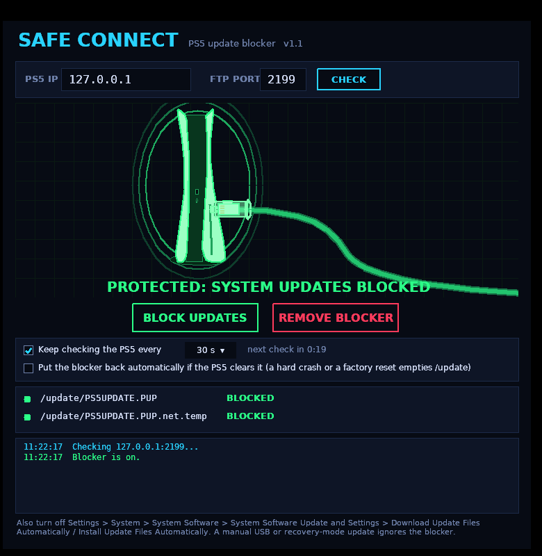
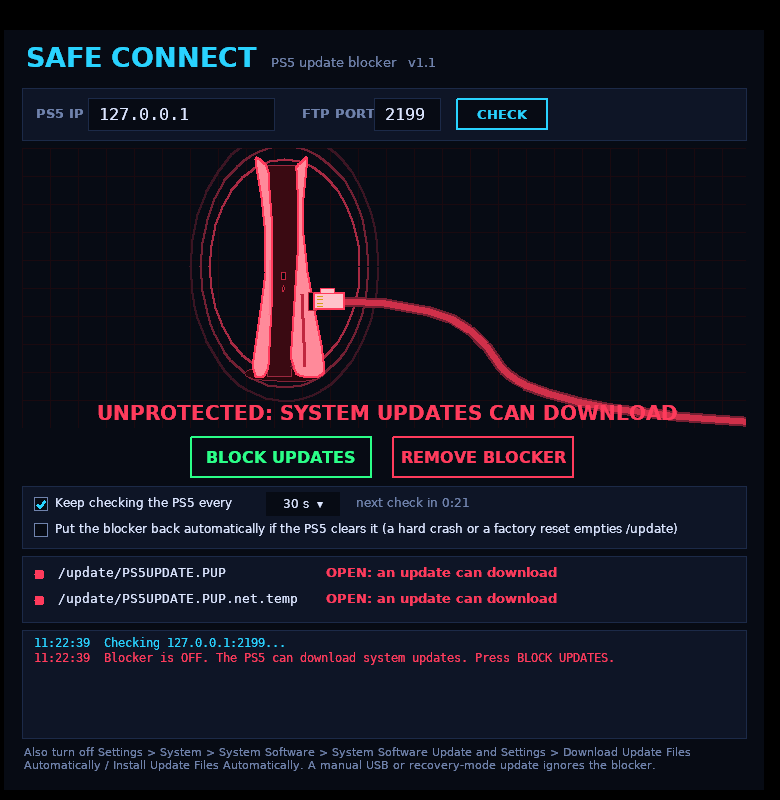
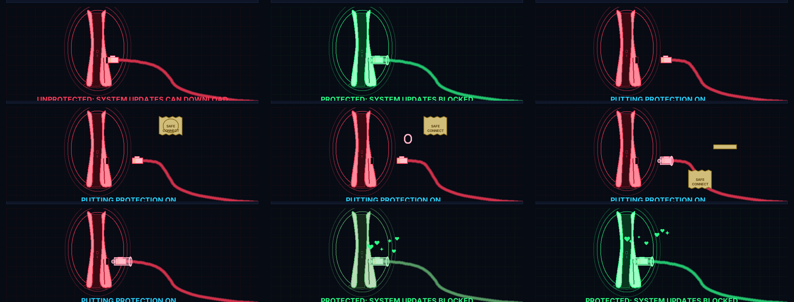

# Safe Connect

A small Windows app that keeps a jailbroken PS5 from downloading system updates. You type in the
console's IP address and FTP port, and the app checks whether updates are blocked. One click
blocks them. The app then keeps checking in the background and puts the block back if the
console ever clears it.



## Download
Get `safe-connect-1.1.exe` from the [Releases](https://gitlab.com/sugah-studios-group/safe-connect/-/releases)
page. It's one native Windows file of about 160 KB, with nothing to install and nothing extra
running in the background.

To run it on the PS5 itself instead, the same page has the payloads (see below).

## What you need
- A PS5 running an FTP server payload with access to `/update`. Most PS5 FTP payloads use
  port **2121**.
- A Windows PC on the same network as the PS5.

## How to use it
1. Start the FTP payload on the PS5.
2. Open Safe Connect. The first time, it shows `0.0.0.0` and `2121`. Type the PS5's IP address and
   press **CHECK**. After that, the app remembers the address and port you used last.
3. The picture shows the result. While the console is **unprotected**, it is drawn in reds. Press
   **BLOCK UPDATES** to protect it. The cable then unplugs, a "SAFE CONNECT" wrapper tears open, a
   condom rolls onto the network plug, the plug goes back in, and everything turns green.
4. You can leave the app running. **Keep checking the PS5 every** (30 s, 1 min, 5 min or 15 min)
   re-checks on a timer. **Put the blocker back automatically** protects the console again if
   the block was cleared. A hard crash or a factory reset can empty `/update`.

The list under the picture shows the state of each update location:

| State | Meaning |
|---|---|
| **BLOCKED** | A folder is in place, so the console has nowhere to save an update. |
| **OPEN** | Nothing is there, so an update can download. |
| **AN UPDATE IS DOWNLOADED HERE** | An update file is already waiting on the console. |
| **folder not reachable** | The FTP server can't open `/update`. |

**REMOVE BLOCKER** asks you to confirm first, then takes the block away. It also turns off
automatic put-back, so the block doesn't come straight back. Be careful: a system update can
end a jailbreak for good.



Also turn these off on the PS5:
- Settings > System > System Software > System Software Update and Settings > **Download Update
  Files Automatically**
- On the same screen, **Install Update Files Automatically**

## How it works
The PS5 saves a downloaded system update in `/update`. It writes the download as
`PS5UPDATE.PUP.net.temp` and renames it to `PS5UPDATE.PUP` when it finishes. Over FTP, Safe
Connect does three things:

1. It deletes any update already downloaded there, finished or half-finished, plus any other
   `PS5UPDATE*` file. This also clears the "update ready" message.
2. It makes a **folder** at each of those names, so a download can't create its file.
3. It puts a read-only file, `prospero-win-update-blocker`, inside each folder so the folder is
   never empty, then makes the folders read-only (`SITE CHMOD 555` / `444`).

Removing the block undoes those steps. A folder that holds anything else is left alone.
Prospero Sender Turbo's Update blocker uses the same names, so either program can undo a block
the other made.

Safe Connect can't stop everything:
- A factory reset or a hard crash can remove the block. Automatic put-back is there for that.
- An update installed by hand, from USB or recovery mode, ignores the block.



## Without the window
```
safe-connect-1.1.exe --check   HOST [PORT]
safe-connect-1.1.exe --block   HOST [PORT]
safe-connect-1.1.exe --unblock HOST [PORT]
```
Each command runs once, prints what it found to the console it was started from, and exits.
The exit code is 0 when updates are blocked and 1 when they aren't.

Settings are stored in `%LOCALAPPDATA%\safe-connect\settings.ini`.

## On the PS5 itself: the payload
`safe_connect.elf` (on the Releases page) does the same block on the console, with no PC involved. Send it to
the payload loader on port 9021. It blocks updates, shows a notification with the result, and
exits. Two more payloads cover the other actions: `safe_connect_unblock.elf` removes the block,
and `safe_connect_check.elf` only reports whether updates are blocked. The payloads and the app
use the same folders, so either one can undo what the other did. See `payload/README.md`.

## Source
- `native/safe_connect.cpp` is the app: C++ with Win32 and GDI+, and its own small FTP client
  over Winsock. Only Windows' own DLLs are used. To build it on Linux or WSL, install
  `g++-mingw-w64-x86-64` and run `bash native/build.sh`.
- `payload/safe_connect.c` is the PS5 payload. To build it, run
  `bash payload/build-safe-connect-elf.sh`, which uses the PS5 payload SDK.
- `src/safe_connect.py` is the same app as a Python script, for any machine with Python 3.10+
  and Tk.

## License
LGPL-2.1. Safe Connect is based on the Update blocker in
[Prospero Sender Turbo](https://gitlab.com/sugah-studios-group/prospero-sender-turbo), which uses the
same license. See `LICENSE`.
